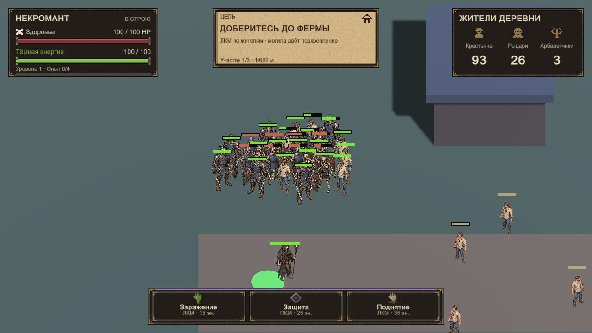

# Интерфейс в игре — итоговый образец

6 ноября 2026. Задача UI №1. Основной размер: 1280×720.

Это неизменённый снимок Game View из JourneyLevel после задач UI №3–4,
сохранённый отдельно от перезаписываемых снимков проверок. Источник —
`review-battle-1280x720.png` из прогона `Logs/ui4-review.log`.
Кадр получен в проверочном сценарии: к уровню временно добавлены 24 бойца
нежити и 8 стражников. Перед снимком они ведут настоящий бой, затем время
останавливается для съёмки. Числа в HUD взяты из состояния этой попытки.
Сцена и prefab от сценария не меняются.

## Композиция и материалы

Слева сверху находятся здоровье, энергия и опыт, по центру — цель,
справа — живые жители деревни. Правая панель соответствует уточнённому
концепту: крестьяне, рыцари и арбалетчики вместо первоначального счётчика орды.
Внизу расположены заражение, защита и поднятие с кнопкой мыши и текущей ценой.

Тёмная кожа и железные оправы отделяют показатели от земли, текст цвета
кости сохраняет контраст. Бордовый цвет здоровья, зелёная энергия и
фиолетовая руна связывают HUD с палитрой персонажей и магии. Декор остаётся
на краях панелей. Для здоровья и энергии используются короткие отклики,
а не постоянная пульсация всей панели.

## Результат просмотра в исходном размере

- В 1280×720 читаются HP, энергия, жители, названия и цены способностей.
- В кадре видны некромант, крестьяне и столкновение со стражей; панели
  не перекрывают центральную группу бойцов.
- Заражение, защита и поднятие различаются формой и подписью.
- На [кадре нехватки ресурсов](review-hud-1280x720.png) опасность обозначена
  разными надписями: «КРИТИЧЕСКОЕ HP» и «Мало энергии».

Дополнительно просмотрены [640×360](review-battle-640x360.png) и
[320×568](review-battle-320x568.png). Панели помещаются, однако мелкие подписи
читаются хуже. В портретном окне панель жителей может закрывать некроманта
в нижней части кадра. Эти размеры остаются вариантами адаптации, а не
основным визуальным образцом; для них полезна отдельная задача компактного HUD
и проверки положения камеры относительно занятой интерфейсом области.

Окружение пока состоит из прототипных поверхностей и зданий. Этот образец
фиксирует внедрённый интерфейс демоверсии и не означает, что рисованное
окружение из концепта с холмом уже перенесено в игру.

## Проверки и повторная съёмка

Прогон Unity 6000.3.24f1 после UI №4 завершился строкой
`PASS: Interface review and Game View captures passed.` в `Logs/ui4-review.log`.
Он покрывает HUD, уведомления, прогрессию, финал, бой толпы и большие значения.
Для этой задачи код не менялся, повторный запуск тех же проверок не потребовался.

Команда редактора: **Necromancer Infection → Run Interface Review**.
Для автоматической съёмки: `InterfaceReviewChecks.PreviewBatch` в пространстве
имён `NecromancerInfection.Editor`. Новый `review-battle-1280x720.png` следует
просмотреть перед обновлением закреплённого `ui-style-in-game.png`.
