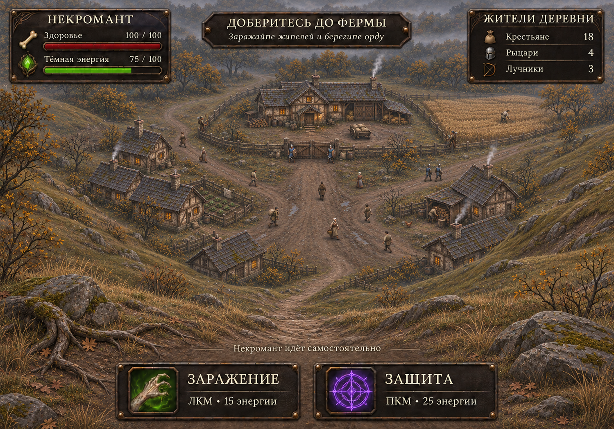

# Интерфейс — визуальный образец v1

Актуальный вариант — `ui-style-mockup-v5-hill.png`: по уточнению пользователя камера находится на холме перед деревней. На переднем плане камни, корни и сухая трава, тропа спускается к домам и конечной ферме. Верхняя правая панель заменена на «Жители деревни»: крестьяне — 18, рыцари — 4, лучники — 3, с отдельными значками. Это демонстрационные числа, не подсчёт NPC на картинке и не установленный баланс уровня. Изменение состава правой панели заменяет первоначальную идею показывать здесь орду. Внедрение потребует связать её с живыми участниками миссии. Окружение остаётся статическим концептом, а не реализованной сценой Unity.

Текущий вариант — `ui-style-mockup-v4-mission.png`. По уточнению пользователя убраны три крупные демонстрационные фигуры, камера поднята и отдалена. В деревне показаны жители в позах ходьбы, фермер, солдаты у ворот, патруль и лучники возле ограды. Конечная ферма остаётся целью в верхней части композиции. Это статический концепт размещения участников миссии: анимация, навигация и NPC в Unity этим изображением не добавлены. Лучники отражают запрос на концепт; существующий игровой дальний противник — арбалетчик. Счётчики и подпись о некроманте остаются демонстрационными элементами HUD.

Актуальное изображение — `ui-style-mockup-v3-village.png`: добавлено рисованное окружение деревни с конечной фермой за воротами. Грязная дорога ведёт к двору; по краям расположены небольшие постройки, за оградой видны поля, телега и припасы. Тёплые окна обозначают ещё живую ферму до захвата. Это концепт будущего окружения, а не снимок реализованного уровня. Генерация изменила масштаб и положение фигур относительно предыдущего варианта; игровую камеру и масштаб юнитов нужно проверить при внедрении. Версия `ui-style-mockup-v2.png` сохраняет нейтральный фон без технического диска, первая версия сохранена для истории.

Результат первого прохода задачи 1 из `UI_ROADMAP.md`. Это концепт оформления, ещё не действующий HUD в Unity. Значения 100 HP, 75 энергии и 12 бойцов иллюстрируют композицию и не отражают состояние сцены.

## Основа и материалы

Изображение создано встроенным imagegen по настоящему кадру `approved-characters-in-game.png`. В центре сохранена композиция тестового кадра с заражённым крестьянином, некромантом и стражником. Генеративный макет может слегка менять исходные пиксели персонажей; для внедрения использовать оригинальные спрайты и отдельные UI-элементы, а не это изображение целиком.

Подложки — тёмная грубая кожа, рамки — потемневшее железо с умеренно тёплыми потёртостями, углы — небольшие заклёпки. Орнамент ограничен краями. Зелёный камень энергии повторяет навершие посоха. Заражение получает зелёный акцент, защита — фиолетовый, здоровье — бордовый.

## Палитра для реализации

Цвета ниже — целевые токены для следующего этапа, а не измеренные цвета всех пикселей макета.

| Назначение | Цвет |
| --- | --- |
| Кожаная подложка | `#211C18` |
| Глубокая тень, пустая полоса | `#100F0D` |
| Железная рамка | `#49433B` |
| Потёртости, заклёпки | `#92754A` |
| Основной текст, кость | `#E9DDC2` |
| Вторичный текст | `#BCAE96` |
| Здоровье | `#912D32` |
| Энергия и заражение | `#83BE46` |
| Яркий центр камня | `#B2E877` |
| Защита | `#A775DB` |

Крупные поверхности матовые. Свечение ограничено камнем и иконками: ореол до 6 px при базе 1280×720, максимальная непрозрачность 20%. Цифры и подписи не светятся. Импульс при действии — 0,15–0,25 с; постоянная пульсация панелей не нужна.

## Типографика

Макет задаёт характер шрифта; сгенерированная надпись не является подключённым шрифтовым файлом. Для первого прототипа использовать доступные в Windows Georgia Bold для заголовков, Segoe UI для пояснений и значений. Оба семейства имеют кириллицу. Перед поставкой выбрать шрифты с лицензией на распространение в игре и проверить фактический рендеринг в Unity; системные файлы Windows в проект не копировать.

Размеры при базе 1280×720: заголовки 20–22 px, основные подписи и значения 17–18 px, вспомогательный текст не меньше 15 px, число орды 38–42 px. Цифры ресурсов сохранять на одной строке. Длинные заголовки переносить или сокращать вручную, не уменьшать бесконечно.

## Композиция для реализации

Макет имеет соотношение сторон тестового снимка 10:7. При переносе на обычный игровой кадр 16:9 сохранять компактные панели и масштабировать их по существующему `HUDLayout`, не растягивать всё изображение.

- Статус: верхний левый угол, здоровье и энергия друг под другом.
- Цель: верхняя центральная часть, короткий заголовок и одна строка пояснения.
- Орда: верхний правый угол, общее число и компактный состав.
- Способности: две плитки снизу по центру с иконкой, названием, кнопкой мыши и ценой.
- Центр экрана: открытая игровая область, без декоративных цепей и обрамления по всему периметру.

Для базы 1280×720 ориентироваться на существующие области: статус 324×148, цель 360×128, орда 284×148, способности 640×80 и наружный отступ 18 px. Иконки способностей 52–56 px; внутренняя зона текста начинается после иконки с отступом 12 px. Не переносить крупную типографику концепта в эти области без проверки вместимости. Для узкого окна применять существующую перестановку панелей из `HUDLayout`.

## Проверка и следующий шаг

Визуально проверены кириллица, разделение двух способностей, читаемость значений и свободный центр. Для сравнения с одеждой и снаряжением в макете оставлены крупные персонажи. Проверка HUD на обычной дистанции камеры, среди толпы, на разных фонах и в маленьком окне относится к внедрению и итоговой задаче 8.

Перед изготовлением полного комплекта требуется выбор пользователем визуального направления, предусмотренный планом. После выбора: отдельные масштабируемые рамки и подложки, реальные шрифты и иконки. Не вырезать буквы и значения из растрового концепта.
